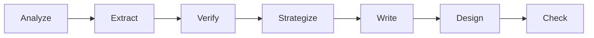
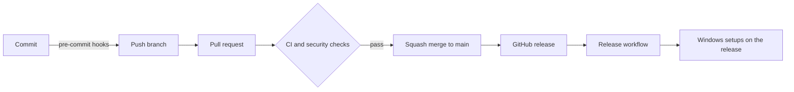
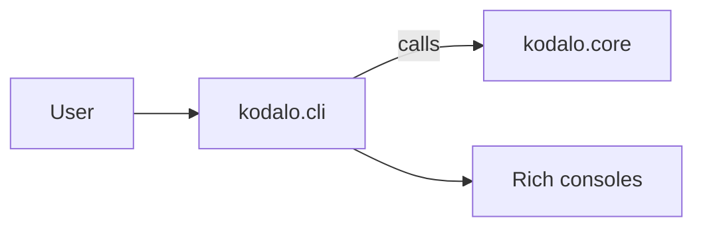
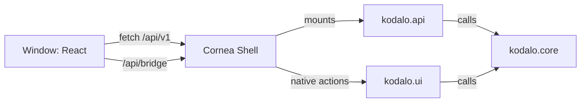

# Architecture

How Kodalo is put together: the product design first, then the repository, checks and release flow. For day-to-day commands, see [development](development.md). For one-time repository settings, see [repository settings](development.md#repository-settings).

## Product design

Kodalo is a local-first Windows application that turns GitHub repositories, or product details entered by hand, into reviewed Instagram content. It owns the product knowledge, content history, review workflow and user experience; the AI model is replaceable. Nothing is published without explicit approval, and the catalog, history and export work without any AI provider.

### Pipeline

Work runs as a sequence of stages. Each stage has a typed input and output, is validated against a versioned JSON Schema (`schema_version`) before the next stage starts, and runs either in code or through the selected AI provider.



| Stage | Output | Runs in |
| --- | --- | --- |
| Analyze | Repository facts: languages, structure, manifests, tooling | Code |
| Extract | Purpose, installation, use cases and raw capabilities, with quoted evidence | Provider |
| Verify | Merged features with a status (`verified`, `partially_verified`, `documented_only`, `planned`) and claim flags | Code and provider |
| Strategize | Strategy, three angles with hooks, five post ideas and a `claims_to_avoid` list | Provider |
| Write | Slide script or single-image copy, caption, alt text and hashtags | Provider |
| Design | One HTML file per slide (1080x1350) and a manifest, from templates and the brand profile | Code |
| Check | Claim tracing, contrast, text fit, length limits and duplicate detection | Code |

Platform-neutral stages (analyze to strategize) do not depend on Instagram. Platform-specific copy and design modules plug in after them, so other platforms can be added later.

### Principles

- **Deterministic work stays in code.** Counting, measuring text fit, checking contrast, matching claims to evidence and confirming that copy matches approved claims never go to a model.
- **Stages are separable and re-runnable.** Each output is stored with a hash of its inputs, so unchanged stages are not re-run, a failed run resumes from the failed stage, and an edit re-runs only the stages after it.
- **Limits line up between stages.** For example, the hook length matches the slide headline length, so no stage produces output the next one cannot use.
- **Honest output.** Copy contains only claims the strategy approved, and missing images stay labelled placeholders instead of invented screenshots.
- **Audit trail.** Every stage records its inputs, settings, model, token use and result.

The stage contracts were prototyped as six Claude skills in `.claude/skills/`; their outputs for one repository are kept as fixtures in `tests/fixtures/sweepito/`.

### Modules

All of this lives in `kodalo.core` (`src/kodalo/core/`); the command line, API and window only call it.

| Package | Role |
| --- | --- |
| `repositories` | Reading a repository through the GitHub CLI, a local folder or a web fetch: file discovery, manifest readers, README and linked docs, social preview and icon images |
| `configs` | Parser, framework and tooling configs that tell the readers what to look for: shipped ones plus the ones the AI writes after an analysis |
| `parsers` | Helpers for HTML, image and SVG content, including cleaning SVG drawings to plain shapes |
| `brands` | Brand profiles and their shared pieces: palettes, layouts and canvases, with contrast checks, export and import |
| `ai` | One client interface per provider, the service that runs a task, the six AI jobs, per-model defaults and the prompts (`prompts/repo`, `palette`, `marketing`, `platforms`) |
| `studio` | The post workflow: source check, ideas, copy and design, with Instagram as the first platform (`platforms/instagram`) |
| `settings` | GitHub access, AI connections and history, platform settings, logs and the window theme |
| `storage` | SQLite database, Alembic migrations, data-folder paths and the bundled catalogues |
| `tunnel` | cloudflared install and the temporary public address Instagram needs to fetch pictures |
| `doctor` | The installation diagnosis shown by `kodalo doctor` and the About page |

### Providers

Four connections are supported: `claude_api`, `claude_code` (the Claude Code CLI), `chatgpt_api` and `gemini_api`. Connections are configured once, globally, and each AI job (`palette`, `repo_metadata`, `repo_features`, `studio_ideas`, `studio_copy`, `studio_design`) can use the default model or one chosen for it. API keys go to the system keychain (`keyring`), never to the database, exports or logs; the history of calls (`ai_calls`) keeps token counts and, only when switched on, the text. Kodalo sends nothing to a provider unless the user runs the action, and every request has a plan route that shows what would be sent first.

### Data

SQLite is the local source of truth. The first migration creates `settings`, `brand_profiles`, `provider_settings` (replaced in migration `0012` by `ai_connections` and `ai_models`; migration `0015` adds `ai_calls`, the history of AI calls), `repositories`, `tools`, `features` and `feature_evidence`; Migration `0003` adds the repository metadata columns and the `repository_languages` table; `stage_runs`, the content tables, `marketing_angles` and `publishing_records` arrive in later migrations with the steps that need them. Rows use UUID4 text ids, UTC ISO-8601 timestamps and CHECK-limited status columns. The database file lives in the per-user data folder (`%LOCALAPPDATA%\Kodalo\kodalo.db`); core takes the folder as a path, and generated files will use a user-configurable data folder.

The code is in `kodalo.core.storage`: SQLAlchemy models, hand-written Alembic migrations kept as package data, and a `Database` handle that migrates on open. The Alembic version table is `schema_migrations`. A copy of the file is kept as `kodalo.db.bak` before any migration, restored if the migration fails, and a database written by a newer version is refused untouched. A test compares the migrated schema with the models so they cannot drift. SQLAlchemy and Alembic are runtime dependencies of the core library: they give typed models and a standard migration tool for a schema that will keep growing. The installer build must include the migration files and Alembic's dynamic imports.

### Brand profiles

`kodalo.core.brands.brand` holds named brand profiles. Each profile has colors (background, primary, secondary and text, each with a light and a dark value, plus an `_alt` set used as accents inside a slide), fonts (heading, body and mono, each with an alternative), a logo and a shared layout (canvas, margins, corner radius, slide numbers, footer, alignment, density, number of slides). The data is validated Pydantic models, stored in `brand_colors`, `brand_fonts` and `brand_logos` (one row per profile, each with a `schema_version`), with `brand_profiles.layout_id` pointing to a row of `layouts` and `brand_fonts` pointing to rows of the `fonts` catalogue. Reusable pieces live in their own packages and tables, each with built-in `system` rows and `user` rows: `canvases` (named sizes, `kodalo.core.brands.canvas`), `layouts` (a canvas plus margins, text settings and a slide count, `kodalo.core.brands.layout`) and `palettes` (the eight colors, `kodalo.core.brands.palette`). Changing a canvas or layout changes everything that uses it, and one in use cannot be deleted; a brand copies a palette's colors, so palettes are never in use; exactly one profile can be the default, enforced by a partial unique index. Fonts come from a catalogue table: a bundled open-licence list plus the fonts installed on Windows, which are added when first seen. Logo files are PNG or SVG, kept under random names in `<data folder>/brand/logos`; SVG files that contain scripts, external links or entities are rejected. Contrast is checked in code and only reported. A profile can be exported to a JSON file with its logos embedded and imported again.

### Content status

Content moves through `draft`, `ready_for_review`, `approved`, `rejected`, `needs_changes`, `publishing`, `published` and `publish_failed`. Approval is bound to the exact copy and asset version and is invalidated by any change. A designed post can be exported to a folder (one JPEG per slide and a caption file) for manual posting, or posted to Instagram through the Instagram API with an explicit action.

## Repository and checks

A change moves through three layers of checks before it reaches `main`, and a release moves through one more before the installers reach users.



## Layers

| Layer | What runs | Where |
| --- | --- | --- |
| Local | gitleaks, file hygiene, markdownlint, actionlint, Ruff, `uv lock` check, mypy, ESLint, Prettier, Vitest, pytest and the Sweepito scan and cleanup | pre-commit hooks |
| Pull request | `ci` (lint, UI checks on Node versions, unit tests on Python 3.11 to 3.15 on Windows with 80% coverage, integration tests, Windows UI test), dependency review, Semgrep, installer build when installer files change, API compatibility when `docs/openapi.json` changes | GitHub Actions |
| Repository | Branch ruleset, secret scanning with push protection, Dependabot alerts and updates, weekly `pip-audit` and `npm audit` | GitHub settings and `audit.yml` |
| Release | Build and smoke-test both setups, checksums, release notes from `CHANGELOG.md` | `release.yml` |

## Source layout

```text
src/kodalo/core/       typed library: all the logic, never prints or exits
src/kodalo/cli/        Typer + Rich command line over the library (brands, repositories, settings, studio)
src/kodalo/api/        FastAPI app over the library: routers, schemas, errors, security, logs
src/kodalo/ui/         Cornea Shell wiring and the `kodalo-ui` command
src/kodalo/ui/ui/      React + Vite frontend (JavaScript); `dist/` is built, not committed
installer/             PyInstaller specs (`cli.spec`, `ui.spec`), NSIS scripts and pinned tool versions
scripts/               OpenAPI export, installer build and release-notes generation
tests/<component>/     pytest tests with coverage (80% minimum): core, cli, api and ui
tests/<component>/integration/   tests marked `integration`: skipped by default, run in CI
docs/                  this documentation, `openapi.json` and the generated CLI reference
pyproject.toml         metadata, dependency groups (`api`, `ui`, `dev`, `installer`) and tool configuration
uv.lock                locked dependency set, checked by CI with --locked
```

One package, `kodalo`, holds all four layers. The version lives in one place, `__version__` in `kodalo/__init__.py`, and Hatchling reads it at build time. The wheel and sdist contain `kodalo.core` and `kodalo.cli` only; `kodalo.api` and `kodalo.ui` are excluded and ship in the Windows installers.

## Library and CLI layers



- `kodalo.cli` parses arguments with Typer, calls `kodalo.core`, and writes all output through the shared Rich consoles: data to stdout, messages and errors to stderr.
- `kodalo.core` holds the logic. It raises exceptions instead of printing or exiting, so every front end reuses it.
- The console script `kodalo` enters through `kodalo.cli.cli:run`, and `python -m kodalo.cli` does the same.

## UI and API layers



- `kodalo.api` validates input, calls `kodalo.core` and shapes responses. It is not a standalone server: the window mounts its routes under Cornea, which authenticates every request with a session cookie. See [API](api.md).
- `kodalo.ui` wires Cornea to the API and the library, registers the native actions (`app_info`, `write_json_file`) and holds the `kodalo-ui` entry point. It is the one place there that shows output and sets exit codes.
- The React frontend reaches Python only through `fetch` and the Cornea bridge, both in `src/libs/api.js`. See [UI](ui.md).
- `kodalo.core` never imports `kodalo.api` or `kodalo.ui`, and `kodalo.api` never imports `kodalo.ui`. The Windows-only dependency (`cornea-shell`) is imported lazily.

## Installers

Releases are installers, not a Python package. `scripts/build_installer.py` builds two products with PyInstaller one-folder builds and NSIS:

| Product | Spec | Contents |
| --- | --- | --- |
| Command line | `installer/pyinstaller/cli.spec` | `kodalo.core` and `kodalo.cli`; the setup can add it to PATH |
| Window | `installer/pyinstaller/ui.spec` | Adds `kodalo.api`, `kodalo.ui`, the built frontend and Cornea; Windows only |

Shared setup behavior lives in `installer/windows/nsis/common.nsh`. Names and the version come from `pyproject.toml` through `installer/projectinfo.py`, and the NSIS version is pinned in `installer/tools.toml`. See [packaging](packaging.md).

## Workflows

| Workflow | Trigger | Purpose |
| --- | --- | --- |
| `ci.yml` | Pull request, push to `main` | Runs `lint`, `ui`, `test`, `integration` and `ui-windows`. A final `ci` job gates on all of them and is a required check. |
| `dependency-review.yml` | Pull request | Blocks pull requests that add vulnerable dependencies. Required check. |
| `api-compat.yml` | Pull request that changes `docs/openapi.json` | Reports breaking API changes with oasdiff. Not required. |
| `security.yml` | Pull request, push, weekly | Semgrep, uploaded as code scanning results. Not required. |
| `audit.yml` | Weekly, manual, and pull requests that change a lock file | Runs `pip-audit` and `npm audit` on the locked dependencies. |
| `build.yml` | Pull request that touches the installers | Builds the Windows setups, installs each, runs it and uninstalls it. Not required. |
| `release.yml` | GitHub release published | Builds and smoke-tests the command line and window setups, attaches them with `SHA256SUMS.txt` to the release, and fills in the release notes from `CHANGELOG.md` when the release has none. |

## Branch governance

The `main` ruleset in `.github/rulesets/main.json` is applied by hand (see [repository settings](development.md#repository-settings)). It requires:

- a pull request with a code owner review and resolved conversations, squash merge only
- the `ci` and `dependency-review` checks, with the branch up to date
- no deletion and no force push

Repository admins can bypass through a pull request so a solo maintainer is not locked out.

## Release flow

1. Bump `__version__` and update `CHANGELOG.md` in a pull request.
2. After merge, publish a GitHub release tagged `v<version>`.
3. `release.yml` builds both setups on Windows (with `--smoke`, which runs the built programs), then a second job downloads them, writes the checksums, attaches everything to the release and fills in the notes. Only the second job can write to the release.
