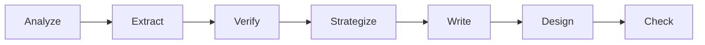
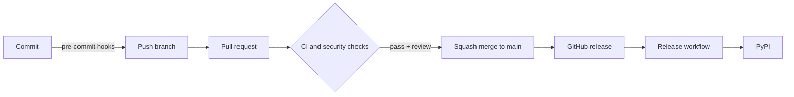
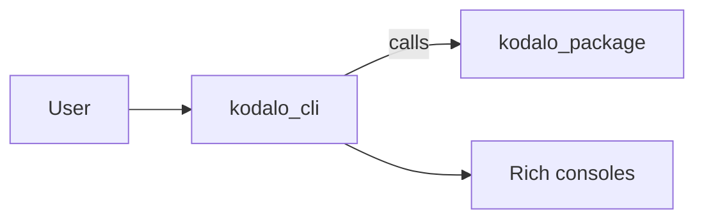
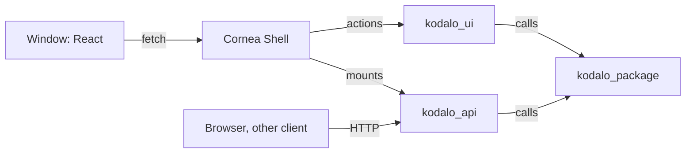

# Architecture

How Kodalo is put together: the product design first, then the repository, checks and release flow. For day-to-day commands, see [development](development.md). For one-time repository settings, see [repository setup](repo-setup.md).

## Product design

Kodalo is a local-first Windows application that turns GitHub repositories, or product details entered by hand, into reviewed Instagram content. It owns the product knowledge, content history, review workflow and user experience; the AI model is replaceable. Nothing is published without explicit approval, and the catalog, history and export work without any AI provider.

### Pipeline

Work runs as a sequence of stages. Each stage has a typed input and output, is validated against a versioned JSON Schema (`schema_version`) before the next stage starts, and runs either in code or through the selected AI provider.



| Stage | Output | Runs in |
| --- | --- | --- |
| Analyze | Repository facts: languages, structure, manifests, tooling | Code |
| Extract | Purpose, installation, use cases and raw capabilities, with quoted evidence | Provider |
| Verify | Merged features with a status (`verified`, `partially_verified`, `documented_only`, `planned`) and claim flags | Code and provider |
| Strategize | Strategy, three angles with hooks, five post ideas and a `claims_to_avoid` list | Provider |
| Write | Slide script or single-image copy, caption, alt text and hashtags | Provider |
| Design | One HTML file per slide (1080x1350) and a manifest, from templates and the brand profile | Code |
| Check | Claim tracing, contrast, text fit, length limits and duplicate detection | Code |

Platform-neutral stages (analyze to strategize) do not depend on Instagram. Platform-specific copy and design modules plug in after them, so other platforms can be added later.

### Principles

- **Deterministic work stays in code.** Counting, measuring text fit, checking contrast, matching claims to evidence and confirming that copy matches approved claims never go to a model.
- **Stages are separable and re-runnable.** Each output is stored with a hash of its inputs, so unchanged stages are not re-run, a failed run resumes from the failed stage, and an edit re-runs only the stages after it.
- **Limits line up between stages.** For example, the hook length matches the slide headline length, so no stage produces output the next one cannot use.
- **Honest output.** Copy contains only claims the strategy approved, and missing images stay labelled placeholders instead of invented screenshots.
- **Audit trail.** Every stage records its inputs, settings, model, token use and result.

The stage contracts were prototyped as six Claude skills in `.claude/skills/`; their outputs for one repository are kept as fixtures in `tests/fixtures/sweepito/`.

### Modules

| Module | Role |
| --- | --- |
| Repository adapter | GitHub access, file discovery and scanning, with size caps and rate-limit handling |
| Catalog | Products, tools, features, evidence and origin (repository, inferred, user-added); rescans keep user edits |
| Settings | Layered values: built-in defaults, global, product, run. A product group is `inherit`, `override` or `own` |
| Brand profiles | Named, reusable colors, fonts, logo and layout, with contrast checks |
| AI providers | One adapter interface: structured generation against a schema, capability report, connection test, token usage and typed errors |
| Stage runner | Prompts, schema validation, caching by input hash, retries, resume and dry-run estimates |
| Content registry | Every draft, approval and publication, with exact and near-duplicate detection |
| Renderer | HTML to PNG with text-fit measurement (renderer choice is still open) |
| Credential store | Windows secure credential storage; secrets never reach the database, exports or logs |

All of this lives in `kodalo_package`; the command line, API and window only call it.

### Providers

The first release supports the Gemini API, the Claude Code CLI and OpenAI-compatible APIs. Ollama and LM Studio follow later. Connections are configured once, globally, and products choose among them. Credentials are never held at product level. The app never switches silently to a provider that could cost money, and a local-only mode limits stages to local connections.

### Data

SQLite is the local source of truth. The first migration creates `settings`, `brand_profiles`, `provider_settings` (replaced in migration `0012` by `ai_connections` and `ai_models`; migration `0015` adds `ai_calls`, the history of AI calls), `repositories`, `tools`, `features` and `feature_evidence`; Migration `0003` adds the repository metadata columns and the `repository_languages` table; `stage_runs`, the content tables, `marketing_angles` and `publishing_records` arrive in later migrations with the steps that need them. Rows use UUID4 text ids, UTC ISO-8601 timestamps and CHECK-limited status columns. The database file lives in the per-user data folder (`%LOCALAPPDATA%\Kodalo\kodalo.db`); core takes the folder as a path, and generated files will use a user-configurable data folder.

The code is in `kodalo.core.storage`: SQLAlchemy models, hand-written Alembic migrations kept as package data, and a `Database` handle that migrates on open. The Alembic version table is `schema_migrations`. A copy of the file is kept as `kodalo.db.bak` before any migration, restored if the migration fails, and a database written by a newer version is refused untouched. A test compares the migrated schema with the models so they cannot drift. SQLAlchemy and Alembic are runtime dependencies of the core library: they give typed models and a standard migration tool for a schema that will keep growing. The installer build must include the migration files and Alembic's dynamic imports.

### Brand profiles

`kodalo.core.brands.brand` holds named brand profiles. Each profile has colors (background, primary, secondary and text, each with a light and a dark value, plus an `_alt` set used as accents inside a slide), fonts (heading, body and mono, each with an alternative), a logo and a shared layout (canvas, margins, corner radius, slide numbers, footer, alignment, density, number of slides). The data is validated Pydantic models, stored in `brand_colors`, `brand_fonts` and `brand_logos` (one row per profile, each with a `schema_version`), with `brand_profiles.layout_id` pointing to a row of `layouts` and `brand_fonts` pointing to rows of the `fonts` catalogue. Reusable pieces live in their own packages and tables, each with built-in `system` rows and `user` rows: `canvases` (named sizes, `kodalo.core.brands.canvas`), `layouts` (a canvas plus margins, text settings and a slide count, `kodalo.core.brands.layout`) and `palettes` (the eight colors, `kodalo.core.brands.palette`). Changing a canvas or layout changes everything that uses it, and one in use cannot be deleted; a brand copies a palette's colors, so palettes are never in use; exactly one profile can be the default, enforced by a partial unique index. Fonts come from a catalogue table: a bundled open-licence list plus the fonts installed on Windows, which are added when first seen. Logo files are PNG or SVG, kept under random names in `<data folder>/brand/logos`; SVG files that contain scripts, external links or entities are rejected. Contrast is checked in code and only reported. A profile can be exported to a JSON file with its logos embedded and imported again.

### Content status

Content moves through `draft`, `ready_for_review`, `approved`, `rejected`, `needs_changes`, `publishing`, `published` and `publish_failed`. Approval is bound to the exact copy and asset version and is invalidated by any change. The first release exports images and captions for manual posting; publishing through the Instagram API is a later, separate adapter.

## Repository and checks

A change moves through three layers of checks before it reaches `main`, and a release moves through one more before it reaches PyPI.



## Layers

| Layer | What runs | Where |
| --- | --- | --- |
| Local | gitleaks, file hygiene, markdownlint, Ruff, `uv lock` check, mypy, Sweepito scan and cleanup | pre-commit hooks |
| Pull request | `ci` (lint, UI checks, unit and integration tests on Python 3.11 to 3.15 on Ubuntu plus 3.11 on Windows and macOS, Windows UI test, build), dependency review, CodeQL | GitHub Actions |
| Repository | Branch ruleset, secret scanning with push protection, Dependabot alerts and updates | GitHub settings |
| Release | Version check, wheel and sdist (core library and command line), trusted publish to PyPI, installers and package-manager updates | `release.yml` |

## Source layout

```text
src/kodalo_package/   typed library: all the logic, never prints or exits
src/kodalo_cli/       Typer + Rich command line over the library
src/kodalo_api/       FastAPI app over the library: routers, schemas, errors, settings
src/kodalo_ui/        Cornea Shell wiring and the `kodalo-ui` command
src/kodalo_ui/ui/     React + Vite frontend (JavaScript); `dist/` is built, not committed
installer/               PyInstaller specs, NSIS scripts, nfpm config and pinned tool versions
scripts/                 repository settings, OpenAPI export, installer build and manifest generation
tests/<component>/     pytest unit tests with coverage (80% minimum), one folder each for core, cli, api and ui
tests/<component>/integration/   tests marked `integration`: skipped by default and in pre-commit, run in CI
pyproject.toml         metadata, dev dependencies and tool configuration
uv.lock                locked dependency set, checked by CI with --locked
```

The version lives in one place, `__version__` in the package, and Hatchling reads it at build time. The release workflow compares it with the release tag.

## Library and CLI layers



- `kodalo_cli` parses arguments with Typer, calls `kodalo_package`, and writes all output through the shared Rich consoles: data to stdout, messages and errors to stderr.
- `kodalo_package` holds the logic. It raises exceptions instead of printing or exiting, so other front ends can reuse it.
- The console script `kodalo` and `python -m kodalo_cli` both enter through `kodalo_cli.cli:app`. Both packages ship in one wheel and share the version in `kodalo_package.__version__`.

## UI and API layers



- `kodalo_api` validates input, calls `kodalo_package` and shapes responses. It runs on its own on any system, or is mounted inside Cornea.
- `kodalo_ui` only wires Cornea to the API and the library, and holds the `kodalo-ui` entry point. It is the one place there that shows output and sets exit codes.
- `kodalo_package` and `kodalo_api` never import `kodalo_ui`, and `kodalo_package` never imports `kodalo_api`. The Windows-only dependency (`cornea-shell`) is imported lazily.

## Workflows

| Workflow | Trigger | Purpose |
| --- | --- | --- |
| `ci.yml` | Pull request, push to `main` | Runs `lint`, `ui`, `test`, `integration`, `ui-windows` and `build`. A final `ci` job gates on all of them and is the only check the ruleset requires. |
| `api-compat.yml` | Pull request that changes `docs/openapi.json` | Reports breaking API changes with oasdiff. Not required. |
| `security.yml` | Pull request, push, weekly | Semgrep, uploaded as code scanning results. Not required. |
| `dependency-review.yml` | Pull request | Blocks pull requests that add vulnerable dependencies. |
| `audit.yml` | Weekly, manual, and pull requests that change a lock file | Runs `pip-audit` and `npm audit` on the locked dependencies to catch newly published vulnerabilities. |
| `build.yml` | Pull request that touches the installers | Builds the Windows setups and Linux packages, installs each, runs it and uninstalls it. Not required. |
| `release.yml` | GitHub release published | Checks the tag matches the version, builds the wheel (core library and command line), publishes to PyPI, builds and optionally signs the installers, attaches them with checksums to the release, and opens Homebrew, Scoop and winget pull requests when switched on. |
| `init.yml` | Manual | One-time: replaces the owner and repository name, renames the example packages and commands to your name, regenerates the lock file and generated docs, and opens a pull request. Skipped in the template itself. |

CodeQL runs through GitHub's default setup rather than a workflow file.

## Branch governance

The `main` ruleset in `.github/rulesets/main.json` is applied by `scripts/apply_repo_settings.py`. It requires:

- a pull request with a code owner review and resolved conversations, squash merge only
- the `ci` and `dependency-review` checks, with the branch up to date
- CodeQL results
- no deletion and no force push

Repository admins can bypass through a pull request so a solo maintainer is not locked out.

## Release flow

1. Bump `__version__` and update `CHANGELOG.md` in a pull request.
2. After merge, publish a GitHub release tagged `v<version>`.
3. `release.yml` builds the sdist and wheel (the core library and the command line only; the API and the window ship in the installers) in one job, then a second job in the `pypi` environment publishes them using OpenID Connect. No API token is stored, and only the publish job gets the `id-token` permission.
