# Kodalo user guide

Kodalo turns your GitHub projects into on-brand Instagram posts. Your brands and content stay on your computer, and nothing is posted without your approval.

This guide walks through every screen of the Kodalo window. The menu on the left is always there, so you can jump between screens at any time.

## Contents

- [The four steps](#the-four-steps)
- [Home](#home)
- [Repositories](#repositories)
- [Studio](#studio)
- [Brands](#brands)
- [Palettes](#palettes)
- [Canvases and layouts](#canvases-and-layouts)
- [Settings](#settings)
- [About](#about)

## The four steps

1. **Add a repository.** Point Kodalo at a project and let it read what it does.
2. **Pick an idea.** Choose a post idea and angle suggested for your project.
3. **Write the copy.** Edit the headline, slides, caption and hashtags.
4. **Design and share.** Slides use your brand. Post to Instagram or export them.

Before you start, open [Settings](#settings) to connect GitHub, choose an AI provider and, if you want to post, connect Instagram.

## Home

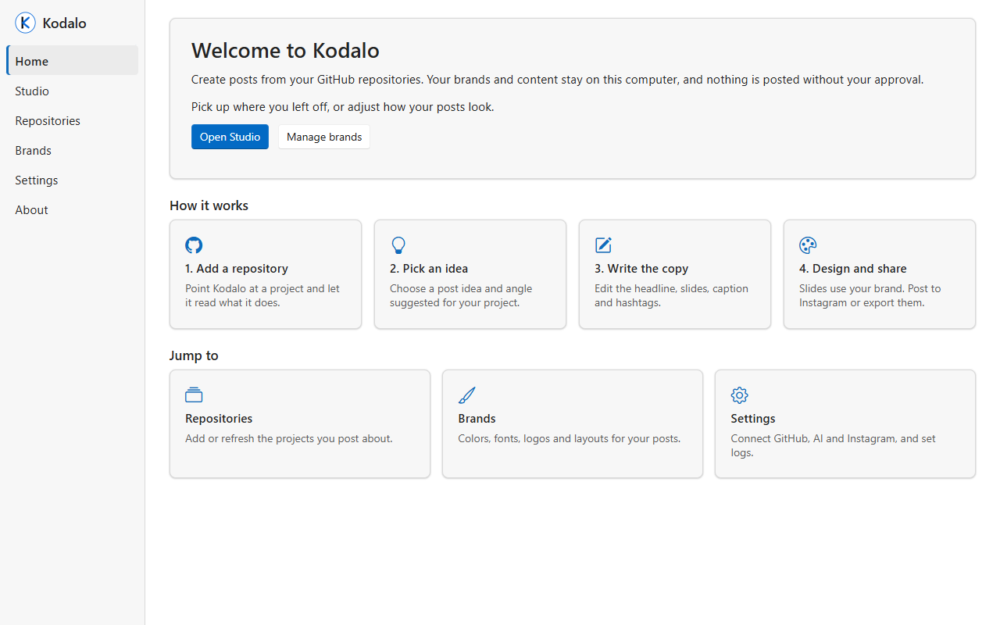

Home explains the four steps above and gives you shortcuts:

- **Open Studio** takes you to where posts are made.
- **Manage brands** opens your brands.
- The **Jump to** cards open Repositories, Brands and Settings.

## Repositories

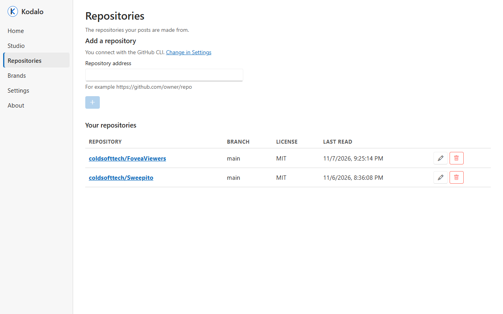

Repositories lists the projects your posts are made from.

**Add a repository**

1. Type the repository address, for example `https://github.com/owner/repo`.
2. Select the **+** button.

Kodalo uses the GitHub connection chosen in [Settings](#github). The **Change in Settings** link on this screen takes you there.

**Your repositories** shows each project's branch, license and when Kodalo last read it. Use the pencil button to refresh or edit a repository and the bin button to remove it.

### Repository details

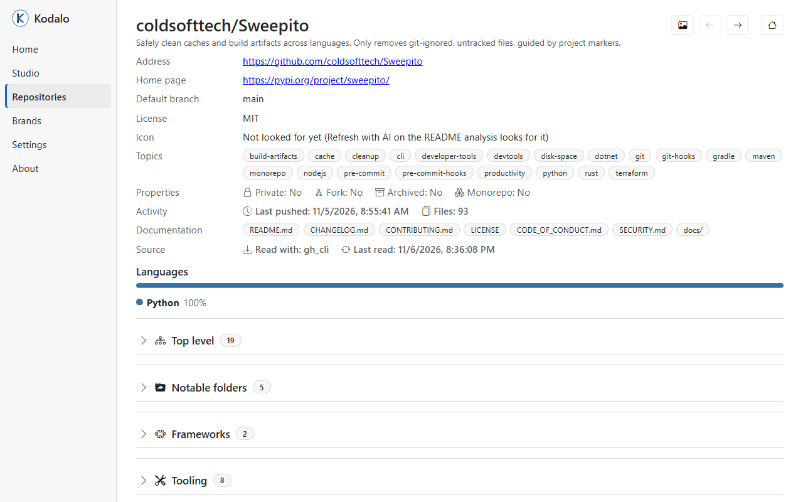

Select a repository's name to see what Kodalo learned about it, including its links.

## Studio

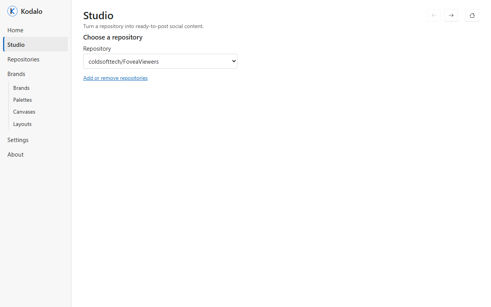

Studio is where a repository becomes a post.

1. Choose a repository from the list. **Add or remove repositories** takes you back to Repositories.
2. Use **Next** (the right arrow, top right) to move on, **Back** (left arrow) to step back, and **Studio home** (house button) to start over.

From there Studio guides you through the focus of the post, the ideas, the text and the design. Some steps use your AI provider; **Refresh with AI** asks it for new suggestions. Before anything is sent to Instagram, Studio shows a **Send to...?** confirmation, and nothing is sent until you select **Proceed**.

> The later Studio steps (focus, ideas, text and design) are not shown here, because they appear only after the AI has analysed a repository.

## Brands

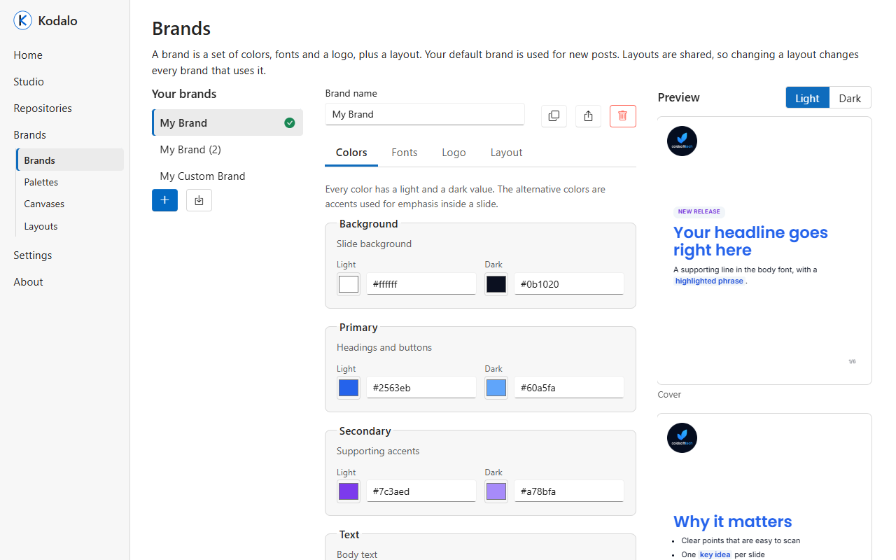

A brand is a set of colors, fonts and a logo, plus a layout. Your default brand (marked with a green tick) is used for new posts.

- Choose a brand on the left to edit it. Use **+** to add one, or the import button to load a brand file.
- Above the editor you can rename the brand, duplicate it, export it or delete it.
- The **Preview** on the right shows how slides look. Switch between **Light** and **Dark**.

The editor has four tabs:

| Tab | What you set |
|---|---|
| **Colors** | Every color has a light and a dark value. Alternative colors are accents used for emphasis inside a slide. |
| **Fonts** | The fonts used in your slides. |
| **Logo** | The logo shown on your slides. |
| **Layout** | The layout the brand uses. |

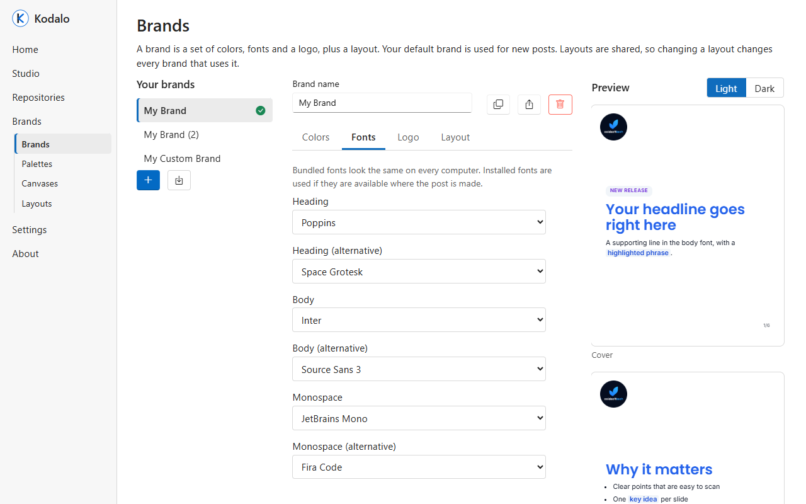

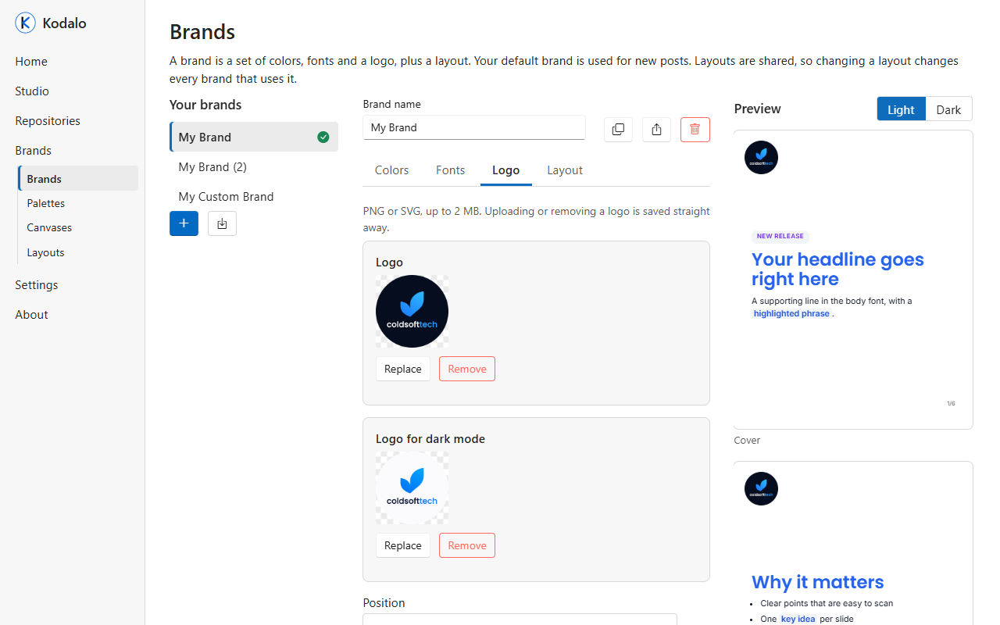

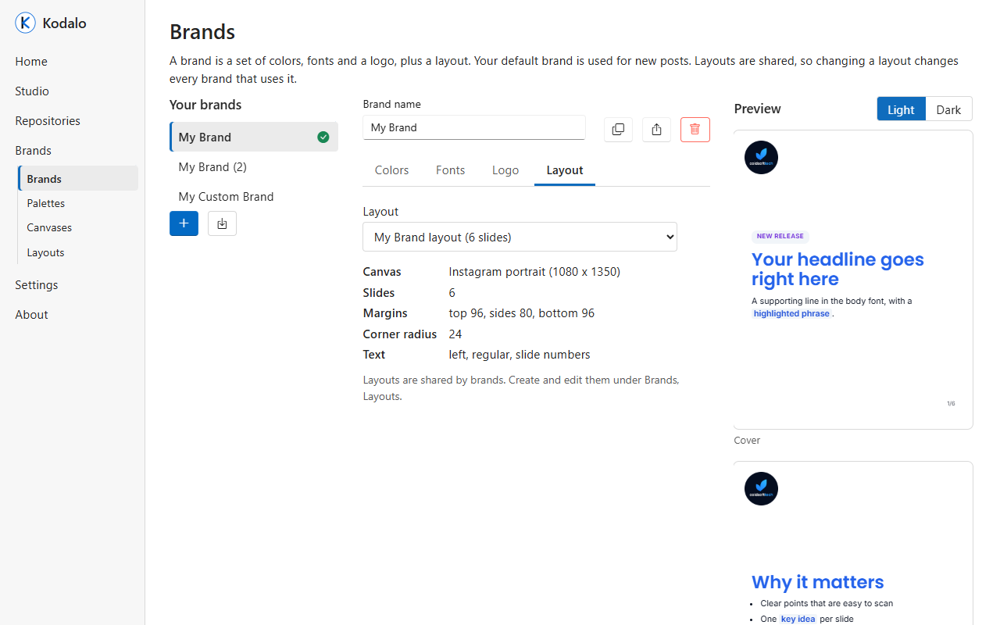

When you open Brands for the first time, Kodalo offers to create your first brand from a palette, or to import a brand file you already have.

## Palettes

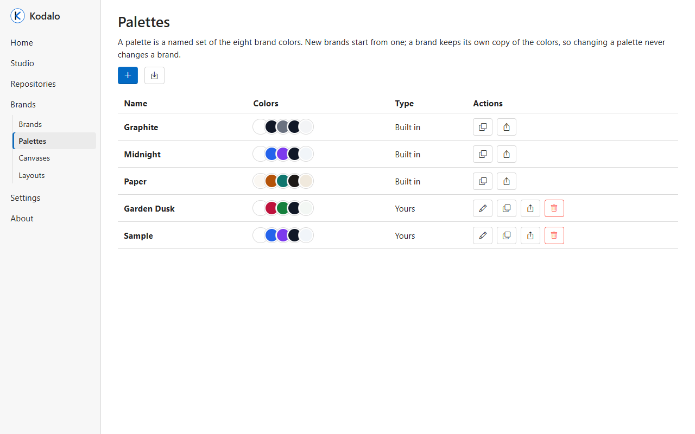

A palette is a named set of the eight brand colors. New brands start from a palette, and a brand keeps its own copy of the colors, so changing a palette never changes a brand.

- **Built in** palettes (such as Graphite, Midnight and Paper) can be duplicated or exported, but not changed.
- **Yours** are palettes you made. You can edit, duplicate, export or delete them.
- Use **+** to create a palette, or the import button to load one.

## Canvases and layouts

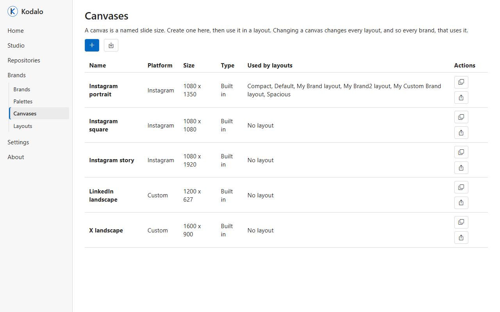

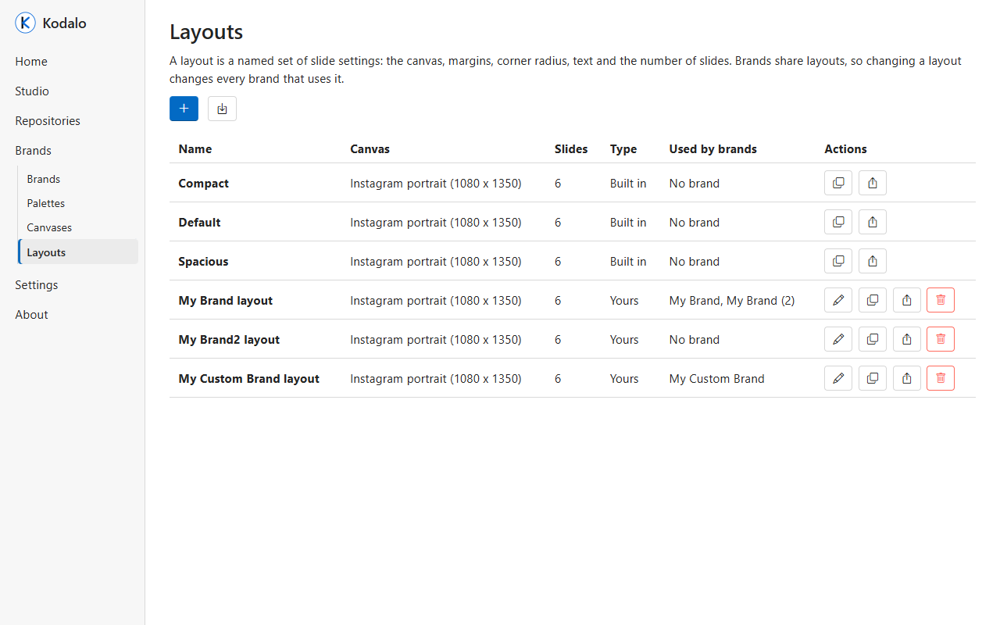

**Canvases** and **Layouts** work like palettes: you can add your own, import and export them, and reuse them across brands. Layouts are shared, so changing a layout changes every brand that uses it.

## Settings

Settings has five tabs: GitHub, AI, Platforms, Logs and Appearance.

### GitHub

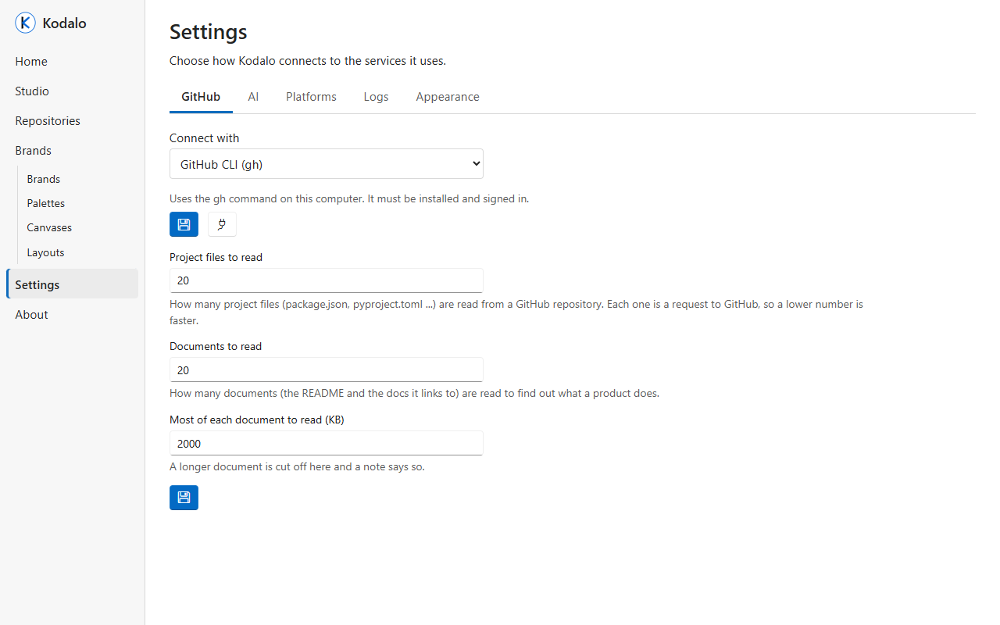

- **Connect with** chooses how Kodalo reaches GitHub. The default uses the GitHub CLI (`gh`) on your computer, which must be installed and signed in.
- Use the plug button to test the connection and the save button to keep your choice.
- **Project files to read**, **Documents to read** and **Most of each document to read (KB)** limit how much Kodalo reads from a repository. Lower numbers are faster.

### AI

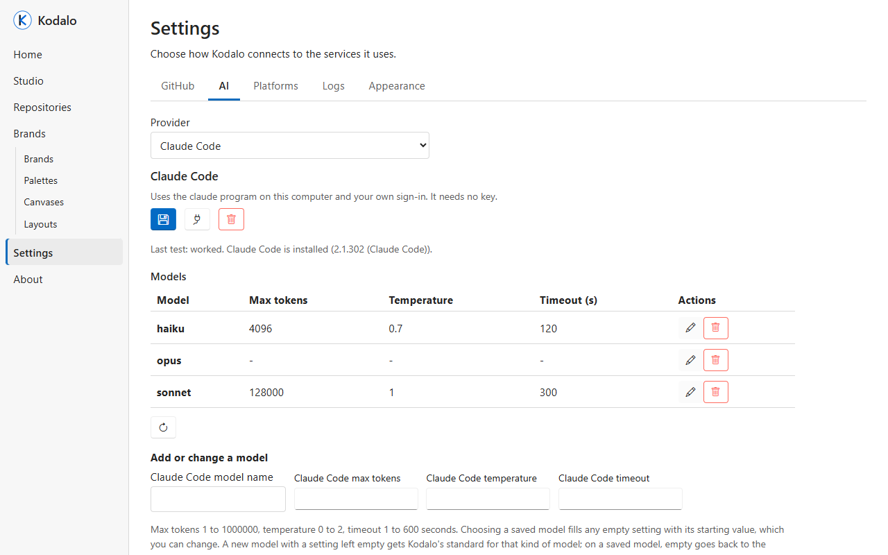

- **Provider** chooses the AI Kodalo uses. Claude Code uses the `claude` program on your computer and your own sign-in, so it needs no key.
- The plug button tests the connection and shows the result of the last test.
- **Models** lists the models you can use, with their maximum tokens, temperature and timeout. Add or change a model in the form below the list.

### Platforms

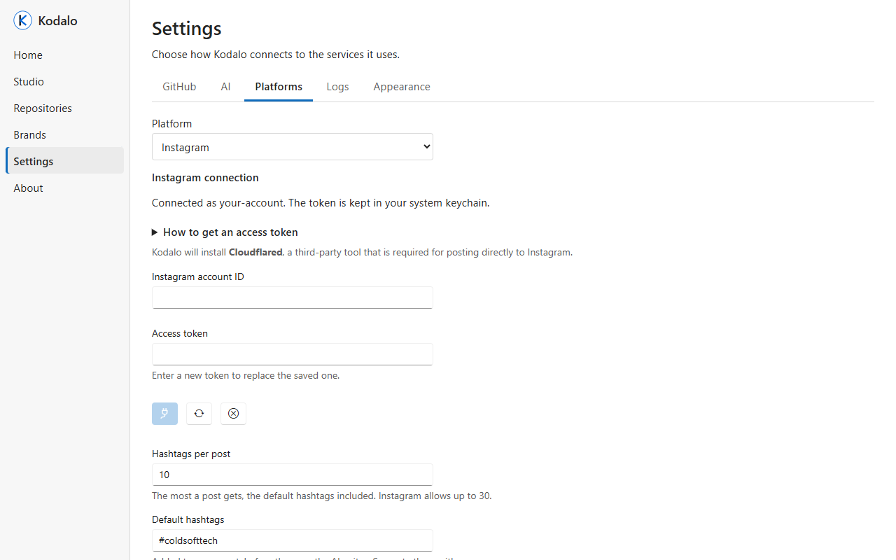

- Choose **Instagram** and connect it with your Instagram account ID and an access token. The token is kept in your system keychain, and only its last characters are shown. Expand **How to get an access token** for steps.
- Posting directly to Instagram needs Cloudflared, a third-party tool. Kodalo installs it for you.
- **Hashtags per post** and **Default hashtags** control the hashtags added to posts. Instagram allows up to 30.

### Logs

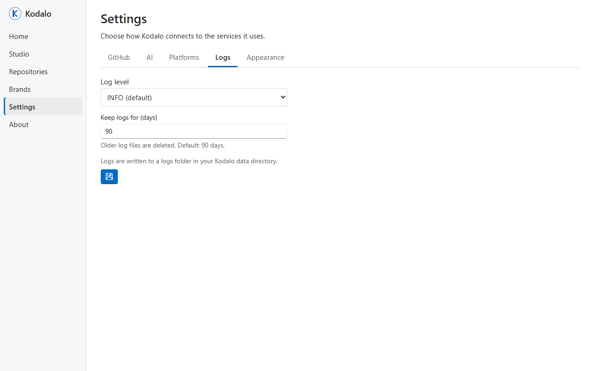

Choose the **Log level** and how many days to **Keep logs for**. Older log files are deleted. The screen also tells you which folder the logs are written to.

### Appearance

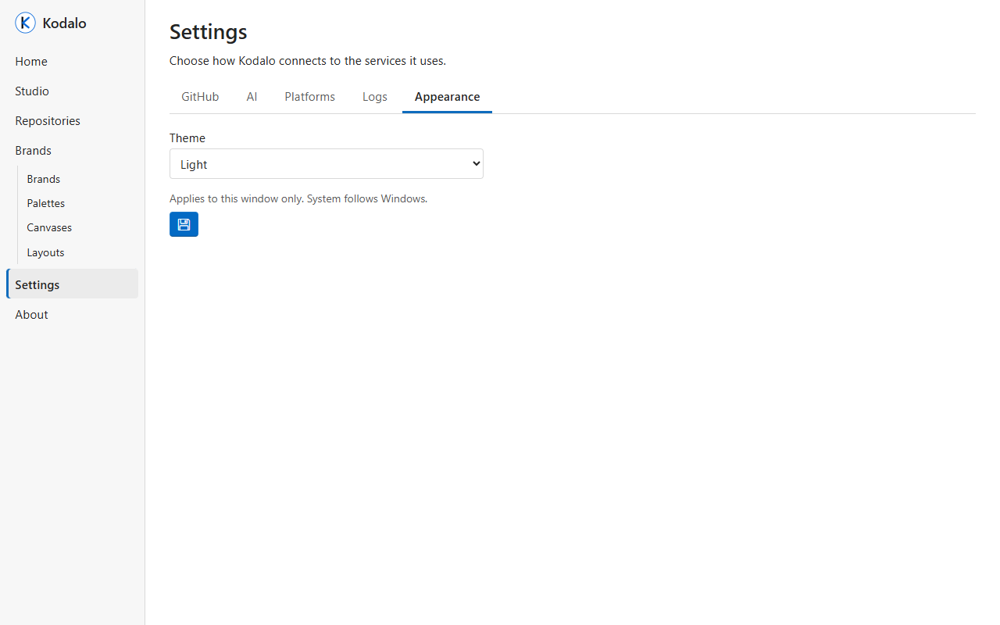

Choose a **Theme**: Light, Dark or System, which follows Windows. It applies to this window only. Select the save button to keep it.

## About

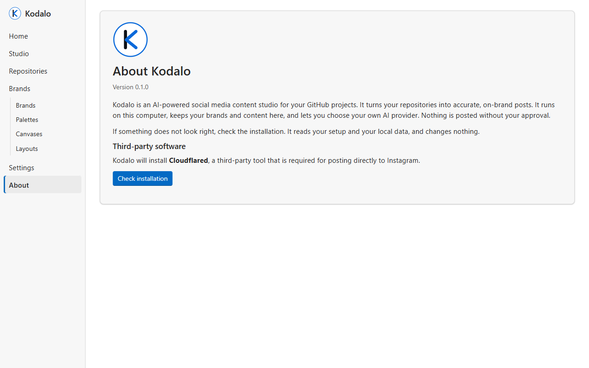

About shows the Kodalo logo and the version you are running.
